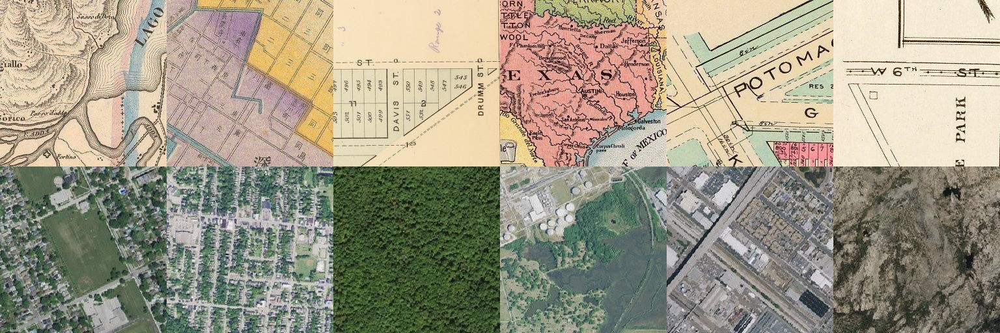

# CycleGAN: mapas históricos ↔ imagens de satélite

Trabalho da disciplina de Aprendizado Não-Supervisionado (PUCRS, Prof. Luan Garcia). Implementamos e treinamos do zero uma CycleGAN para tradução de imagens **não pareada** e analisamos criticamente os resultados.

Para reproduzir o treino, veja [COMO_RODAR.md](COMO_RODAR.md).

## Tradução escolhida e motivação

**Mapa histórico (A) ↔ ortoimagem de satélite (B).**

- **A → B:** dado um mapa antigo, gerar como a região "aparece de cima".
- **B → A:** dado uma foto aérea, gerar um mapa no estilo histórico.

Os dois domínios descrevem o mesmo tipo de coisa (ruas, quadras, rios, ferrovias), mas com aparências muito diferentes. Isso torna o problema interessante para uma CycleGAN, e também difícil: o mapa é uma abstração, com traço, cor chapada e texto, e a foto tem textura e informação que o mapa não carrega (telhados, árvores, sombras). Por isso a tradução não é bijetiva, e esperamos ver aí tanto sucessos quanto falhas informativas para a análise crítica. O par mapa↔aéreo também é o clássico do pix2pix (Isola et al., 2017), mas aqui os dados **não são pareados**.

## Domínios e dataset

Todas as imagens são JPEG 256×256 RGB.

| Domínio | Conteúdo | Treino | Teste |
|---|---|---|---|
| A | recortes de mapas históricos (David Rumsey Map Collection): cadastrais, topográficos, rodoviários, muitos com texto | 6099 | 1056 |
| B | ortoimagens aéreas do USGS de cidades dos EUA, nos zooms 14–16 | 6586 | 947 |

As cidades do conjunto de teste são **diferentes** das de treino, para que o teste meça generalização e não memorização.



*Seis exemplos de A (em cima) e de B (embaixo). Gerada com `uv run python analyze.py dataset --data data`.*

### Origem dos dados

- **Domínio A:** David Rumsey Map Collection.
- **Domínio B:** USGS National Map (ortoimagens).
- **TODO (grupo):** descrever como os dados foram coletados (ferramenta ou script, critério de escolha das cidades e dos mapas, como foram feitos os recortes 256×256, filtros e limpeza, licença de uso).

Os dados (≈ 553 MB) não ficam no repositório.

## Implementação

Seguimos a CycleGAN original (Zhu et al., 2017). Tudo está em PyTorch, sem dependências além de PIL e matplotlib.

### Arquitetura

- **Geradores `G_AB` e `G_BA`: ResNet de 9 blocos.** `c7s1-64, d128, d256, 9×R256, u128, u64, c7s1-3`, com ReflectionPad, InstanceNorm e ReLU, e saída `tanh` em [-1, 1]. Para 256×256 a literatura usa 9 blocos; o resnet preserva bem a estrutura espacial (o que é desejável aqui, pois o traçado de ruas deve ser mantido), e a InstanceNorm funciona melhor que a BatchNorm em tradução de estilo com batch 1.
- **Discriminadores `D_A` e `D_B`: PatchGAN 70×70.** `C64 - C128 - C256 - C512 - conv 1 canal`, LeakyReLU 0.2, InstanceNorm (sem norma na primeira camada). Para entrada de 256 px, a saída é um mapa 30×30 de decisões real/falso, cada uma olhando um trecho de 70×70 px. Julgar texturas locais é o que importa para estilo, e tem poucos parâmetros e funciona com qualquer tamanho de imagem.
- Inicialização dos pesos: normal com desvio 0,02.

### Perdas

- **Adversarial LSGAN** (erro quadrático contra 1/0, sem sigmoid). Gradientes mais estáveis que a entropia cruzada e sem saturação; é a escolha do paper original. A perda do D é multiplicada por 0,5 para que ele aprenda mais devagar que o G.
- **Consistência cíclica L1, λ = 10.** `a → G_AB → G_BA ≈ a` (e o análogo para B). É o que permite treinar sem pares: obriga a tradução a manter o conteúdo. L1 gera menos borrão que L2.
- **Identity desligada no treino principal** (`λ_id = 0`). Nos mapas, a identity forçaria `G_AB(b) ≈ b`, o que não é natural aqui (um gerador de B a partir de B). Ela serve sobretudo para preservar cor, e o domínio de satélite já tem paleta própria. Vamos testá-la em uma **ablação** curta (`λ_id = 0,5`) para medir o efeito.
- **Image pool** de 50 imagens falsas para o D, que estabiliza o treino (Shrivastava et al., 2017).

### Otimização

- Adam, `lr = 2e-4`, betas `(0.5, 0.999)`, batch 1.
- **Agendamento de LR fixo em 100 épocas:** o LR fica constante até a época 50 e depois cai linearmente, chegando perto de zero na época 100. O valor de cada época é calculado direto dos argumentos (`epoca`, `epochs`, `decay-start`), sem estado de scheduler. Assim o treino pode ser interrompido e retomado a qualquer hora sem alterar o agendamento.
- **AMP fp16** ligado por padrão para caber em 6 GB de VRAM (RTX 2060). As perdas são calculadas em float32.
- Uma época = `max(|A|, |B|)` = 6586 iterações. O lado A segue a ordem embaralhada e B é sorteado aleatoriamente, o que mantém o treino não pareado.

### Por que não há data augmentation

Não usamos flip nem outras transformações. O flip horizontal espelharia o **texto dos mapas**, criando exemplos que não existem no domínio. Também não há recorte aleatório: as imagens já têm 256×256 e os recortes foram feitos na coleta. Com ~6 mil imagens por domínio e PatchGAN com poucos parâmetros, o risco de sobreajuste é moderado, e deixamos a avaliação dele para a análise (curvas e casos de teste).

## Estrutura do repositório

```
README.md           este arquivo
COMO_RODAR.md       passo a passo do treino no PC com GPU (Windows)
pyproject.toml      dependências (uv)
models.py           geradores, discriminadores, E/S de imagem
train.py            treino, checkpoints e retomada
analyze.py          figuras e análises a partir de runs/
tests/              teste de fumaça (CPU)
figuras/            figuras gerais (dataset)
runs/<run>/         saída de cada treino: config.json, perdas.csv, epocas.csv,
                    amostras/epoca_XXX.jpg, curvas_*.png, evolucao_*.jpg
slides/             apresentações em HTML
data/               (fora do git) trainA/ trainB/ testA/ testB/
```

Os pesos (`*.pt`) ficam fora do git.

## Resultados e análise

> Esta seção será preenchida depois do treino principal.

### Treino

- Hardware: RTX 2060 6 GB, AMP fp16, batch 1.
- Parâmetros: _a preencher a partir de `runs/principal/config.json`_.
- Tempo por época: _TODO_ s. Tempo total: _TODO_ h.
- Curvas adversariais: _TODO (`runs/principal/curvas_adversarial.png`)_.
- Curva da perda cíclica: _TODO (`runs/principal/curvas_ciclica.png`)_.

### Evolução por época

_TODO: `runs/principal/evolucao_A.jpg` e `evolucao_B.jpg` (imagens de teste)._

### Casos bons e ruins

_TODO: mesma quantidade de casos para A→B e B→A, só imagens do conjunto de teste._

### Análise crítica

_TODO: para cada falha, hipótese + evidência. Pontos a investigar: alucinação de texto e legendas, perda de detalhes finos na volta B→A, esteganografia (Chu et al., 2017), colapso de modo, efeito da identity (ablação), diferença entre as cidades de treino e de teste._

## Autores

- João Henrique da Luz
- Vittor Brits
- Marcelo

## Referências

- Zhu, Park, Isola, Efros. *Unpaired Image-to-Image Translation using Cycle-Consistent Adversarial Networks.* ICCV 2017.
- Isola, Zhu, Zhou, Efros. *Image-to-Image Translation with Conditional Adversarial Networks (pix2pix).* CVPR 2017.
- Mao et al. *Least Squares Generative Adversarial Networks.* ICCV 2017.
- Shrivastava et al. *Learning from Simulated and Unsupervised Images through Adversarial Training.* CVPR 2017 (image pool).
- Chu, Zhmoginov, Sandler. *CycleGAN, a Master of Steganography.* 2017.
- Dados: [David Rumsey Map Collection](https://www.davidrumsey.com/) e [USGS National Map](https://www.usgs.gov/programs/national-geospatial-program/national-map).
